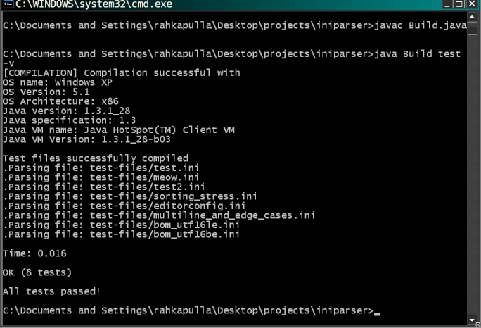

# INI File Parser

### Requirements

- Java 1.3+
  - Tested on Linux (Java version: 1.3.1_20, Specification: 1.3, VM: Java HotSpot(TM) Client VM 1.3.1_20-b03, Kernel: 6.12.107+deb13-amd64 i386)
  - Tested on Windows XP (Java version: 1.3.1_28, Specification: 1.3, VM: Java HotSpot(TM) Client VM 1.3.1_28-b03, OS Version: 5.1 x86)
  - Tested on Sun/Oracle JDK 1.5 (Version: 1.5.0_10, Specification: 1.5, VM: Java HotSpot(TM) 64-Bit Server VM 1.5.0_10-b03)
  - Tested on Zulu OpenJDK 1.6.0-119
  - Tested on OpenJDK 11 (Version: 11.0.32.1, Specification: 11, VM: OpenJDK 64-Bit Server VM 11.0.32.1+10-LTS)
  - Tested on OpenJDK 17 (Version: 17.0.17, Specification: 17, VM: OpenJDK 64-Bit Server VM 17.0.17+10-Debian-1deb12u1)



---

### How to build?

Java 11+
```console
java Build.java
```

Java 3 – 10
```console
javac Build.java && java Build
```

Maven:
```console
mvn compile
```

---

### How to run tests?

The project uses JUnit 3.8.1 on legacy runtimes (Java 1.3 / 1.4) and JUnit 4.8.2 on modern JVMs (Java 5+). Both libraries are vendored in the `lib/` directory, and `Build.java` dynamically selects the appropriate version and runner.

Java 11+
```console
java Build.java test
```

Java 3 – 10
```console
javac Build.java && java Build test
```

Maven:
```console
mvn test
```

---

### About the Parser

This parser implements key-value pair and section parsing inspired by the [EditorConfig File Format Specification](https://spec.editorconfig.org/#file-format).

- **Encoding & BOM**: Supports UTF-8, UTF-16BE, and UTF-16LE with automatic Byte Order Mark (BOM) detection and stripping.
- **Comments** start with `;` or `#` (inline comments are ignored at the end of a value).
- **Section headers** start with `[` and end with a `]`. Properties defined before any section header are assigned to the `"global"` section.
- **Key-Value Pairs** contain a key and a value separated by `=`.
- **Multiline values** use a trailing backslash (`\`) at the end of the line to continue onto the next line (leading indentation on subsequent lines is stripped):

```ini
[service]
description = Background indexing service \
  responsible for ingesting INI files \
  and sorting key pairs
threads = 4
```

The parsed values are stored in an **`IniFile`** object returned by `Iniparser.parse(filepath)`. Retrieve values using `inifile.getValue(String section, String key)`.
